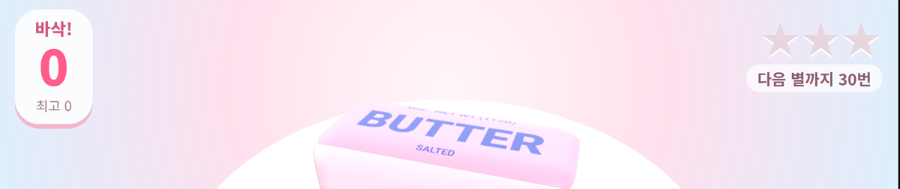

# 바삭 버터 말랑이 (Crunchy Butter Squishy)



누르면 **바삭바삭**, 잡아당기면 **쭉~** 늘어나고, 놓으면 **출렁** 돌아오는 3D 버터바 말랑이입니다.
아이들이 손가락으로 주무르며 노는 터치 장난감으로, [three.js](https://threejs.org/)로 만들었고 브라우저만 있으면 됩니다.

> A soft-body "butter bar" squishy toy for kids, built with three.js. Press it to hear a crunch,
> drag to stretch it, let go and watch it jiggle back. No build step, no assets, no tracking.

## 놀이 방법

| 하는 것 | 일어나는 일 |
|---|---|
| 꾹 누르기 | 바삭 소리 + 부스러기 + 진동. 오래 누르면 더 깊이 눌리고 주변이 불룩해집니다 |
| 잡고 당기기 | 버터가 쭉 늘어나고 "쭉~ ○○cm" 기록이 뜹니다 |
| 손 떼기 | 젤리처럼 출렁이며 제자리로 돌아옵니다 |
| 두 손가락 | 두 군데를 동시에 누르거나 당길 수 있습니다 |

- **미션**: 바삭 30 · 80 · 150번마다 별을 받고, 150번이면 무지개 버터가 열립니다
- **버터 고르기**: 딸기 · 민트 · 버터 (+ 무지개)
- **토핑**: 스프링클을 뿌리면 버터에 붙어서 같이 출렁입니다
- 최고 기록은 기기에만 저장됩니다(localStorage). 서버로 아무것도 보내지 않습니다

## 실행

정적 파일 세 개(`index.html`, `game.js`, `vendor/three.min.js`)뿐입니다. 아무 웹서버로 폴더를 열면 됩니다.

```sh
# 둘 중 하나
python -m http.server 8000
npx serve .
```

그리고 `http://localhost:8000` 을 엽니다. 같은 와이파이의 휴대폰에서는 `http://<PC의 IP>:8000` 으로 열 수 있습니다.
주소 끝에 `?start` 를 붙이면 시작 화면 없이 바로 놀 수 있습니다(소리는 첫 터치 때 켜집니다).

일부 모바일 브라우저는 내려받은 HTML 파일을 직접(`file://`) 열지 못하므로 웹서버로 여는 것을 권합니다.
GitHub Pages 같은 정적 호스팅에 그대로 올려도 동작합니다.

## 동작 기기

- Galaxy Z Fold4 Chrome에서 아이가 실제로 가지고 놀며 확인했습니다
- 화면 크기가 바뀌면(접기·펼치기, 회전) 카메라를 다시 맞추고, 아래 버튼줄에 버터가 가리지 않게 장면을 올립니다
- 터치·마우스 모두 됩니다(Pointer Events). 진동은 지원하는 안드로이드 브라우저에서만 납니다

## 어떻게 만들었나

- **말랑한 몸체**: 둥근 모서리 상자의 꼭짓점마다 스프링(제자리로 돌아가는 힘)과 감쇠를 둡니다.
  손가락이 닿은 곳 주변은 가우시안 가중치로 목표 위치로 끌려가고, 손을 떼면 스프링만 남아 출렁입니다
- **누르기**: 닿은 면의 안쪽으로 밀고, 그 둘레는 바깥으로 살짝 부풀려 부피가 있는 느낌을 냅니다
- **소리**: 녹음 파일 없이 Web Audio로 합성합니다. 바삭 소리는 짧은 고음 노이즈 조각 여러 개, 쭈욱 소리는 저역 필터를 훑는 노이즈입니다
- **이음매 없는 음영**: 상자 면의 경계에서 겹친 꼭짓점의 법선을 프레임마다 평균냅니다
- **에셋 0개**: 라벨 글씨·무지개 무늬는 Canvas로 그리고, 아이콘도 인라인 SVG입니다

## 파일 구조

```
index.html          화면(UI·스타일)
game.js             장면·물리·입력·소리·미션
vendor/three.min.js three.js r149 (MIT)
```

## 크레딧

- 아이디어: 버터바 말랑이를 주무르는 ASMR 영상([쪼물다 jjomulda](https://www.youtube.com/shorts/LqYPkDBK-Io))에서 영감을 받았습니다
- [three.js](https://github.com/mrdoob/three.js) — MIT License, `vendor/three.LICENSE` 참고

## 라이선스

[MIT](LICENSE)
